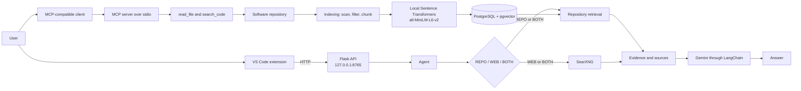

# Developer Intelligence MCP

Developer Intelligence MCP analyzes a software repository and answers developer questions using repository evidence. It combines repository inspection tools, semantic retrieval, and a Gemini-powered agent; SearXNG can provide web evidence for questions that need current or external information.

## Features

- **MCP repository tools:** read a repository-relative file and search repository files using an MCP-compatible client.
- **Repository RAG:** scan, filter, and chunk repository files; retrieve relevant code and documentation.
- **Local embeddings and vector storage:** Sentence Transformers `all-MiniLM-L6-v2` embeddings run locally on CPU and are stored with chunks in PostgreSQL using `pgvector`.
- **Agent and language model:** the agent selects repository (`REPO`), web (`WEB`), or combined (`BOTH`) sources and uses Gemini through LangChain to produce an answer.
- **Evidence tracking:** answers include repository file paths and line ranges or web result titles and URLs.
- **Web search:** SearXNG provides web results through its HTTP search API.
- **Conversation history:** the API persists recent follow-up context in PostgreSQL; direct in-process agent calls can use memory.
- **Local interfaces:** a Flask `/ask` API and a VS Code extension with a sidebar view and Command Palette command.
- **Automated tests:** tests cover repository tools, retrieval, agent behavior, and SearXNG response handling.

## Architecture



The MCP server exposes repository tools over stdio; the Flask API is a separate interface to the agent.

## Technology stack

| Area | Technologies |
| --- | --- |
| Language | Python 3.10+ |
| Repository tools | MCP Python SDK |
| Retrieval and embeddings | Sentence Transformers, `all-MiniLM-L6-v2` |
| Vector storage | PostgreSQL, `pgvector`, psycopg |
| Language model | Gemini through LangChain and `langchain-google-genai` |
| Web search | SearXNG, Docker Compose, Requests |
| HTTP API | Flask |
| Editor integration | VS Code extension (JavaScript) |
| Tests | `unittest`-based tests; runnable with pytest if installed |

## Project structure

```text
.
├── agent/                 # Agent flow and in-memory conversation history
├── rag/                   # Repository scanning, chunking, embeddings, indexing, retrieval
├── server/
│   ├── agent_api.py       # Flask /ask endpoint
│   ├── llm_config.py      # Gemini configuration
│   └── mcp_server.py      # MCP stdio server
├── tools/                 # Repository and SearXNG tools
├── tests/                 # Automated tests
├── vscode-extension/      # Minimal VS Code extension
├── searxng/               # SearXNG settings
├── docker-compose.yml     # Starts PostgreSQL/pgvector and SearXNG
├── requirements.txt
└── README.md
```

## Setup

### Windows PowerShell

```powershell
git clone https://github.com/polinenim/developer-intelligence-MCP.git
cd developer-intelligence-MCP
python -m venv .venv
```

```powershell
.\.venv\Scripts\Activate.ps1
pip install -r requirements.txt
```

If PowerShell blocks activation, run `Set-ExecutionPolicy -Scope Process -ExecutionPolicy Bypass` in that terminal and activate the environment again. This applies only to the current PowerShell process.

Create a local `.env` without overwriting an existing one, then edit it:

```powershell
if (-not (Test-Path .env)) { Copy-Item .env.example .env }
notepad .env
```

Set `POSTGRES_PASSWORD` and `GEMINI_API_KEY` in `.env`. `POSTGRES_USER` and `POSTGRES_DB` default to `developer` and `developer_intelligence`. Set `REPOSITORY_ROOT` to the repository you want to index; `.` selects the current project when you run commands from its root.

The PostgreSQL host port defaults to `5433`. If it is occupied, set `POSTGRES_PORT` in `.env` to another available port. Leave `DATABASE_URL` blank and the application derives it from the PostgreSQL settings, or, if you set it explicitly, make sure its port and credentials match those settings. URL-encode special characters in an explicit URL password. In `.env`, single-quote a password containing `$` so Compose does not treat it as variable interpolation.

The project-root `.env` is loaded by the Flask API, repository indexer, and MCP server. Shell environment variables take precedence over `.env`; a non-empty explicit `DATABASE_URL` takes precedence over the derived URL. Remove stale shell variables if you want `.env` settings to apply. Never commit `.env` or real credentials; `.env.example` contains safe placeholders.

### Start the project

Start PostgreSQL and SearXNG:

```powershell
docker compose up -d
```

On the initial setup, index the configured repository once:

```powershell
python -m rag.indexing
```

Start the Flask API:

```powershell
python -m server.agent_api
```

Keep that terminal open while using the API. In VS Code, open the repository and press F5 to launch the Extension Development Host.

For subsequent launches, activate `.venv` in PowerShell, run `docker compose up -d`, and start the API with `python -m server.agent_api`. You do not need to reinstall dependencies or rerun indexing unless dependencies change or you want to refresh the indexed repository.

The Compose PostgreSQL service uses pgvector, creates the configured database and user, and stores data in a project-scoped named volume. Its initialization script enables `vector` and grants permissions to the configured PostgreSQL user on a fresh database; the application creates its repository table and index during the initial indexing run. Initialization scripts run only when the data directory is empty, and normal service restarts preserve the named volume.

## Running the system

### Flask API

Start the API from the project root, with the environment variables configured above:

```sh
python -m server.agent_api
```

It listens on `http://127.0.0.1:8765` and accepts `POST /ask` with a JSON `question` field and an optional `repository_root`:

```json
{
    "question": "Where is authentication handled?",
    "repository_root": "/path/to/repository",
    "conversation_id": "optional-client-generated-id"
}
```

Send a request from macOS/Linux:

```sh
curl -X POST http://127.0.0.1:8765/ask \
  -H "Content-Type: application/json" \
  -d '{"question":"Where is authentication handled?","repository_root":"/path/to/repository"}'
```

Or from Windows PowerShell:

```powershell
Invoke-RestMethod -Uri http://127.0.0.1:8765/ask -Method Post `
  -ContentType "application/json" `
  -Body '{"question":"Where is authentication handled?","repository_root":"C:\path\to\repository"}'
```

`conversation_id` is optional; reuse an ID to keep follow-up context between requests. The API stores up to 20 turns per conversation in the same PostgreSQL database used for repository retrieval and includes the latest 10 in the model context. It creates the `conversation_turns` table and its index on first use; the database role needs permission to create them. Requests without a conversation ID are not added to conversation history. Direct in-process agent calls without a PostgreSQL history store use memory instead. The response is JSON containing the answer, source details, and evidence; `source_errors` reports repository or web sources that could not be reached. A missing or blank `question`, a question over 4,000 characters, an invalid conversation ID, or a `repository_root` that is not an existing directory returns HTTP 400. Request bodies over 64 KiB return HTTP 413. The VS Code extension supplies the active workspace as `repository_root` and maintains a conversation ID per workspace for follow-up questions.

### VS Code extension

Start the Flask API first. Open `vscode-extension/` as the extension root in VS Code and press **F5** to launch an Extension Development Host. Use **Developer Intelligence: Open Chat Panel** for the dedicated chat panel, or continue using **Developer Intelligence: Ask Question** and the existing sidebar. The extension sends questions to the local Flask endpoint.

### MCP server

For MCP-compatible clients, configure the client to launch `python -m server.mcp_server` from the project root using the Python environment and `REPOSITORY_ROOT` configuration above. The server communicates over stdio and exposes `read_file` and `search_code`; it is separate from the Flask agent API.

## Usage examples

Ask repository questions through the API or VS Code extension:

- “How does authentication work?”
- “Which function creates the JWT token?”
- “Which files are responsible for database access?”

Ask questions that need web information:

- “What is the latest Python version?”
- “Who won IPL 2026?”

The agent chooses repository evidence, web results, or both according to the question. Web answers require a reachable SearXNG instance; repository answers require the target repository to be indexed for semantic retrieval.

## Conversation history

API conversation history is stored in PostgreSQL and survives API restarts; direct in-process agent history is held in memory and cleared when that process restarts.

## Testing

The test cases use `unittest` and can be run with pytest:

```sh
python -m pytest -q
```

Pytest is not listed in `requirements.txt`; install it separately if it is not already available in the environment.

## Current limitations

- The VS Code extension is minimal and connects only to the local Flask endpoint at `127.0.0.1:8765`.
- The MCP server provides only repository file-reading and text-search tools; use the Flask API for agent questions.
